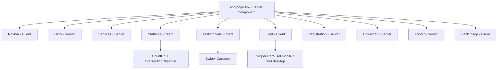
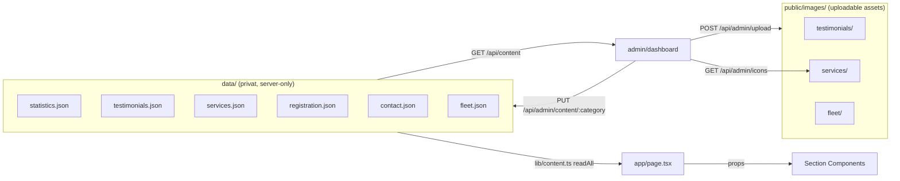

# Design Document: Mahkota Drive Landing Page

## Overview

Landing page Mahkota Drive adalah halaman web tunggal (single-page) yang berfungsi sebagai media pemasaran digital untuk bisnis jasa rental armada kendaraan bagi supir taksi online. Tujuan utama halaman ini adalah mengonversi pengunjung menjadi mitra driver yang terdaftar melalui penyampaian informasi yang jelas, menarik, dan mudah diakses.

### Tujuan Desain

- **Konversi**: Mendorong pengunjung untuk mengklik CTA "Daftar Sekarang" atau mengunduh aplikasi mobile.
- **Kepercayaan**: Menampilkan statistik bisnis, testimoni, dan profil yang meyakinkan.
- **Performa**: Mencapai skor PageSpeed Insights ≥ 80 (mobile) dan ≥ 85 (desktop).
- **Aksesibilitas**: Memenuhi standar WCAG 2.1 Level AA.
- **Kompatibilitas**: Berfungsi penuh di Chrome, Firefox, Safari, dan Edge versi terbaru.

### Identitas Visual (Brand)

Logo Mahkota Drive adalah monogram "MD" dengan mahkota di atas, dirender dalam warna emas bertekstur di atas latar hitam. Identitas visual ini mencerminkan karakter brand yang **premium, profesional, dan berkelas**.

**Palet Warna (Tailwind config):**

| Token Tailwind | Nilai | Penggunaan |
|---|---|---|
| `gold.DEFAULT` | `#C9A84C` | Aksen utama, CTA, highlight |
| `gold.light` | `#E2C97E` | Hover state, gradient |
| `gold.dark` | `#A07830` | Active state, border |
| `brand.black` | `#0D0D0D` | Background utama (dark sections) |
| `brand.dark` | `#1A1A1A` | Background sekunder |
| `brand.card` | `#242424` | Background kartu di dark section |
| `gray.50` | `#F5F5F5` | Background section terang |
| `gray.500` | `#888888` | Teks sekunder/subtitle |

**Tipografi (Tailwind config):**

| Token | Font | Fallback |
|---|---|---|
| `font-heading` | `Playfair Display` | Georgia, serif |
| `font-body` | `Poppins` | system-ui, sans-serif |

Kedua font di-load via `next/font/google` dengan `display: swap` — otomatis self-hosted oleh Next.js tanpa request ke Google Fonts saat runtime.

**Tema Halaman:**
- Section gelap (`bg-brand-black`): Hero, Statistik, Footer
- Section terang (`bg-gray-50`): Layanan, Cara Daftar
- Section bergantian gelap-terang menciptakan ritme visual yang dinamis

---

### Pendekatan Teknis

Proyek ini dibangun menggunakan **Next.js 14+ (App Router) + TypeScript + Tailwind CSS v3**, di-deploy ke VPS dengan `next start`.

**Mengapa Next.js:**
1. **Satu project untuk frontend + backend** — Route Handlers menggantikan Express, tidak perlu server terpisah.
2. **Server Components** — konten landing page dirender di server, mengurangi JavaScript yang dikirim ke browser → PageSpeed tinggi.
3. **`next/image`** — optimasi gambar otomatis (WebP, resize, lazy loading) tanpa konfigurasi manual.
4. **`next/font`** — font di-self-host otomatis, tidak ada request ke Google Fonts CDN saat runtime.
5. **TypeScript** — type safety untuk data konten, API, dan validasi.
6. **Tailwind CSS v3** — di-build saat `next build`, output CSS hanya berisi class yang dipakai.

**Library pihak ketiga:**
- [Swiper](https://swiperjs.com/) — carousel testimoni mobile (npm package, bukan CDN)
- [countup.js](https://inorganik.github.io/countUp.js/) — animasi count-up statistik (npm package)
- [iron-session](https://github.com/vvo/iron-session) — encrypted session untuk autentikasi admin (stateless, tidak butuh session store)
- [bcryptjs](https://www.npmjs.com/package/bcryptjs) — hashing password admin
- [zod](https://zod.dev/) — validasi dan sanitasi input TypeScript-first

---

### Security Architecture

Keamanan diimplementasikan berlapis (defense in depth):

**Layer 1 — Pemisahan Direktori Next.js:**
- `data/` dan `config/` berada di root project, **di luar** `public/`
- Next.js hanya melayani file di `public/` sebagai aset statis
- File JSON sensitif hanya bisa diakses oleh server-side code (Route Handlers, Server Components)

**Layer 2 — Security Headers via `next.config.ts`:**
```typescript
// next.config.ts
const securityHeaders = [
  { key: 'X-Content-Type-Options', value: 'nosniff' },
  { key: 'X-Frame-Options', value: 'DENY' },
  { key: 'X-XSS-Protection', value: '1; mode=block' },
  { key: 'Content-Security-Policy', value: "default-src 'self'; script-src 'self'; style-src 'self' 'unsafe-inline';" },
];
```

**Layer 3 — Rate Limiting via Middleware:**
```typescript
// middleware.ts — rate limit login endpoint
import { NextResponse } from 'next/server';
// Menggunakan in-memory Map atau upstash/ratelimit untuk production
```

**Layer 4 — Encrypted Session via iron-session:**
```typescript
// lib/auth.ts
import { getIronSession } from 'iron-session';
// Session di-encrypt dengan SESSION_SECRET dari .env.local
// Cookie: httpOnly, secure (production), sameSite: 'strict', maxAge: 3600
```

**Layer 5 — Input Validation via Zod:**
```typescript
// lib/validation.ts
import { z } from 'zod';
// Semua input dari PUT /api/admin/content/:category divalidasi dengan Zod schema
```

---

## Architecture

### Struktur File

```
mahkota-drive-landing-page/
├── app/
│   ├── page.tsx                    # Landing page (Server Component)
│   ├── layout.tsx                  # Root layout (font, metadata, favicon)
│   ├── globals.css                 # @tailwind base/components/utilities
│   ├── favicon.ico                 # Favicon (generated from logo.png)
│   ├── admin/
│   │   ├── page.tsx                # Login admin
│   │   └── dashboard/
│   │       └── page.tsx            # Dashboard admin (Client Component)
│   └── api/
│       ├── content/
│       │   └── route.ts            # GET /api/content (publik)
│       └── admin/
│           ├── login/route.ts      # POST /api/admin/login
│           ├── logout/route.ts     # POST /api/admin/logout
│           ├── upload/route.ts     # POST /api/admin/upload (image upload, maks 2MB)
│           ├── icons/route.ts      # GET /api/admin/icons (list available icons)
│           └── content/
│               └── [category]/route.ts  # PUT /api/admin/content/:category
├── components/
│   ├── sections/
│   │   ├── Navbar.tsx              # Sticky navbar (Client Component, h-14/h-16)
│   │   ├── Hero.tsx                # Hero / Tentang Kami (reads heroDescription/heroImageUrl from data)
│   │   ├── Services.tsx            # Layanan (dynamic icons for advantages)
│   │   ├── Statistics.tsx          # Statistik (Client Component untuk animasi)
│   │   ├── Testimonials.tsx        # Testimoni (Client Component, horizontal card layout)
│   │   ├── Fleet.tsx               # Katalog Armada (Client Component, Swiper carousel mobile / grid desktop)
│   │   ├── Registration.tsx        # Cara Daftar (icons only, no step numbers, arrow connectors)
│   │   ├── Download.tsx            # Unduh Aplikasi (reads appMockupUrl from data)
│   │   └── Footer.tsx              # Footer
│   ├── ui/
│   │   ├── BackToTop.tsx           # Tombol back-to-top (Client Component)
│   │   ├── StarRating.tsx          # Rating bintang
│   │   ├── Avatar.tsx              # Foto profil / inisial fallback
│   │   └── PlayStoreButton.tsx     # Tombol Play Store reusable
│   └── admin/
│       ├── Toast.tsx               # Toast notification (success/error, auto-dismiss 3s)
│       ├── ConfirmDialog.tsx       # Confirm dialog (modal, replace window.confirm)
│       ├── IconPicker.tsx          # Visual icon picker grid + upload (for services/registration)
│       ├── PhotoUpload.tsx         # Photo upload with preview (for testimonials/fleet)
│       ├── StatisticsTab.tsx       # Tab edit statistik (3-column grid)
│       ├── TestimonialsTab.tsx     # Tab CRUD testimoni (modal forms, auto-save)
│       ├── ServicesTab.tsx         # Tab edit layanan (sub-tabs: Layanan + Keunggulan)
│       ├── RegistrationTab.tsx     # Tab CRUD cara daftar (modal forms, auto-save)
│       ├── ContactTab.tsx          # Tab "General" (sub-tabs: Profil & Media, Kontak & Sosial Media)
│       └── FleetTab.tsx            # Tab CRUD armada kendaraan (modal forms, auto-save)
├── lib/
│   ├── content.ts                  # Fungsi baca/tulis file JSON per kategori (6 kategori)
│   ├── auth.ts                     # iron-session config + helper functions
│   ├── validation.ts               # Zod schemas per kategori (termasuk fleet)
│   └── rate-limit.ts              # Rate limiter untuk login
├── types/
│   └── content.ts                  # TypeScript interfaces untuk semua data
├── data/                           # PRIVAT — di luar public/
│   ├── statistics.json
│   ├── testimonials.json
│   ├── services.json
│   ├── registration.json
│   ├── contact.json
│   └── fleet.json
├── config/                         # PRIVAT — di luar public/
│   └── admin.json                  # { username, passwordHash }
├── public/
│   ├── favicon-32x32.png           # Generated from logo.png
│   ├── favicon-16x16.png           # Generated from logo.png
│   ├── apple-touch-icon.png        # Generated from logo.png
│   └── images/
│       ├── logo.png
│       ├── hero-bg.webp
│       ├── app-mockup.webp
│       ├── google-play-badge.png
│       ├── services/               # Service/advantage icons (uploadable)
│       ├── testimonials/           # Testimonial photos (uploadable)
│       └── fleet/                  # Fleet vehicle images (uploadable)
├── middleware.ts                   # Rate limiting, auth redirect, login→dashboard redirect
├── next.config.ts                  # Security headers (CSP production-only), image config
├── tailwind.config.ts              # Warna brand, font
├── tsconfig.json
├── package.json
├── .env.local                      # SESSION_SECRET — TIDAK di-commit
├── .env.example                    # Template tanpa nilai sensitif
└── .gitignore                      # .env.local, data/, config/, node_modules/, .next/
```

**Prinsip keamanan direktori:**
- `data/` dan `config/` di root project → tidak bisa diakses via URL
- Hanya `public/` yang dilayani sebagai aset statis oleh Next.js
- `.gitignore` mengecualikan `.env.local`, `data/`, `config/`

### Arsitektur Halaman



### Alur Data Konten



### TypeScript Interfaces

```typescript
// types/content.ts
export interface StatisticItem {
  id: string;
  label: string;       // 1–30 karakter
  value: number;       // integer ≥ 0 atau float 1.0–5.0
  suffix: string;
  decimals?: number;
}

export interface Testimonial {
  id: string;
  name: string;        // non-kosong
  description?: string; // e.g. "Driver Gojek Jakarta"
  photoUrl: string | null;
  quote: string;       // non-kosong
  rating: number;      // integer 1–5
}

export interface Service {
  id: string;
  name: string;
  description: string; // ≤ 150 karakter
  iconUrl: string;
  iconAlt: string;     // non-kosong
}

export interface Advantage {
  id: string;
  title: string;
  description: string; // ≤ 100 karakter
  iconUrl?: string;
  iconAlt?: string;
}

export interface FleetVehicle {
  id: string;
  name: string;        // nama/tipe kendaraan
  year: number;        // 2000–2030
  capacity: number;    // 1–20
  transmission: 'manual' | 'matic';
  imageUrl?: string;
}

export interface FleetData {
  vehicles: FleetVehicle[];
}

export interface RegistrationStep {
  id: string;
  order: number;       // unik
  title: string;       // non-kosong
  description: string; // non-kosong
  iconUrl: string;
}

export interface StatisticsData { items: StatisticItem[]; }
export interface TestimonialsData { items: Testimonial[]; }
export interface ServicesData { services: Service[]; advantages: Advantage[]; }
export interface RegistrationData {
  steps: RegistrationStep[];
  estimateMinutes: number; // 5–15
  formUrl: string;
  playStoreUrl: string;
}
export interface ContactData {
  whatsappUrl: string;
  phone: string;
  address: string;
  socialMedia: { instagram: string | null; facebook: string | null; };
  heroDescription?: string;
  heroImageUrl?: string;
  appMockupUrl?: string;
}
```

### API Endpoints

| Method | Path | Auth | Deskripsi |
|---|---|---|---|
| `GET` | `/api/content` | Publik | Gabungan semua kategori |
| `POST` | `/api/admin/login` | — | Login admin |
| `POST` | `/api/admin/logout` | Admin | Logout admin |
| `PUT` | `/api/admin/content/[category]` | Admin | Update satu kategori |
| `POST` | `/api/admin/upload` | Admin | Upload gambar (maks 2MB) |
| `GET` | `/api/admin/icons` | Admin | List icon yang tersedia |

### Tailwind Config

```typescript
// tailwind.config.ts
import type { Config } from 'tailwindcss';

const config: Config = {
  content: ['./app/**/*.{ts,tsx}', './components/**/*.{ts,tsx}'],
  theme: {
    extend: {
      colors: {
        gold: { DEFAULT: '#C9A84C', light: '#E2C97E', dark: '#A07830' },
        brand: { black: '#0D0D0D', dark: '#1A1A1A', card: '#242424' },
      },
      fontFamily: {
        heading: ['var(--font-playfair)', 'Georgia', 'serif'],
        body: ['var(--font-poppins)', 'system-ui', 'sans-serif'],
      },
    },
  },
};
export default config;
```

---

## Components and Interfaces

### Server Components (tidak kirim JS ke browser)
- `Hero.tsx` — H1 "Mahkota Drive", deskripsi bisnis, CTA Play Store
- `Services.tsx` — Grid kartu layanan + keunggulan
- `Registration.tsx` — Langkah pendaftaran step-by-step
- `Download.tsx` — Mockup aplikasi + tombol Play Store
- `Footer.tsx` — Kontak, alamat, media sosial, Play Store

### Client Components (butuh interaktivitas browser)
- `Navbar.tsx` — Sticky navbar + scroll detection + mobile menu
- `Statistics.tsx` — CountUp animasi + IntersectionObserver
- `Testimonials.tsx` — Swiper carousel (mobile) / grid (desktop)
- `Fleet.tsx` — Katalog armada, Swiper carousel (mobile) / grid (desktop)
- `BackToTop.tsx` — Visibility toggle berdasarkan scroll position
- `Avatar.tsx` — Foto profil dengan `onError` fallback ke inisial

### Admin Components (semua Client Components)
- `LoginForm.tsx` — Form login dengan error handling
- `DashboardTabs.tsx` — Tab navigasi: Statistik, Testimoni, Layanan, Armada, Cara Daftar, General
- `StatisticsTab.tsx` — Edit 3 metrik statistik
- `TestimonialsTab.tsx` — CRUD testimoni
- `ServicesTab.tsx` — CRUD layanan + keunggulan
- `FleetTab.tsx` — CRUD armada kendaraan
- `RegistrationTab.tsx` — CRUD langkah + estimasi waktu
- `ContactTab.tsx` — Tab "General" (profil & media + kontak & sosial media)
- `Toast.tsx` — Toast notification (success/error, auto-dismiss 3s)
- `ConfirmDialog.tsx` — Modal konfirmasi hapus
- `IconPicker.tsx` — Visual icon picker grid + upload
- `PhotoUpload.tsx` — Upload foto dengan preview

---

## Admin Panel UX Patterns

- **Modal Forms**: Semua operasi tambah/edit menggunakan form modal dialog (bukan inline)
- **Auto-save**: Perubahan pada Testimoni, Layanan, Cara Daftar, dan Armada langsung tersimpan ke server
- **Toast Notifications**: Notifikasi sukses/error muncul di pojok kanan atas (auto-dismiss 3 detik)
- **Confirm Dialog**: Hapus data menampilkan modal konfirmasi dengan tombol Batal/Hapus
- **Sub-tabs**: Tab Layanan memiliki sub-tab "Layanan" dan "Keunggulan". Tab General memiliki sub-tab "Profil & Media" dan "Kontak & Sosial Media"
- **Icon Picker**: Input icon menggunakan grid visual yang menampilkan semua icon tersedia + opsi upload baru
- **Photo Upload**: Upload foto dengan preview, drag-to-replace, tombol hapus

---

## Data Models

Data konten disimpan dalam 6 file JSON terpisah di `data/` (lihat TypeScript interfaces di atas).

### Validasi dengan Zod

```typescript
// lib/validation.ts
import { z } from 'zod';

export const statisticsSchema = z.object({
  items: z.array(z.object({
    id: z.string(),
    label: z.string().min(1).max(30),
    value: z.number().min(0),
    suffix: z.string(),
    decimals: z.number().optional(),
  })).length(3),
});

export const testimonialsSchema = z.object({
  items: z.array(z.object({
    id: z.string(),
    name: z.string().min(1),
    photoUrl: z.string().nullable(),
    quote: z.string().min(1),
    rating: z.number().int().min(1).max(5),
  })).min(3),
});

// ... schemas untuk services, registration, contact
```

---

## Correctness Properties

(Semua 25 properties dari design sebelumnya tetap berlaku — tidak ada perubahan pada properti kebenaran karena perubahan stack tech tidak mengubah perilaku yang diharapkan dari sisi pengguna.)

---

## Error Handling

| Skenario | Penanganan |
|---|---|
| Logo gagal dimuat | `next/image` `onError` → tampilkan teks "Mahkota Drive" |
| Foto profil gagal | `Avatar.tsx` `onError` → tampilkan inisial |
| Swiper gagal import | Dynamic import dengan fallback grid statis |
| CountUp gagal import | Tampilkan nilai final langsung tanpa animasi |
| File JSON tidak ditemukan | Route Handler return 500 + log error |
| Validasi Zod gagal | Route Handler return 400 + daftar error |

---

## Testing Strategy

**Unit Tests:** Vitest + React Testing Library
- Validasi Zod schemas
- Fungsi `lib/content.ts` (baca/tulis JSON)
- Komponen UI (StarRating, Avatar, PlayStoreButton)

**Property-Based Tests:** fast-check + Vitest
- Semua 25 correctness properties

**E2E Tests:** Playwright
- Cross-browser (Chrome, Firefox, WebKit)
- Responsivitas (320px, 768px, 1024px, 1440px)
- Aksesibilitas (axe-core)
- Admin panel flow (login → edit → save → verify)
